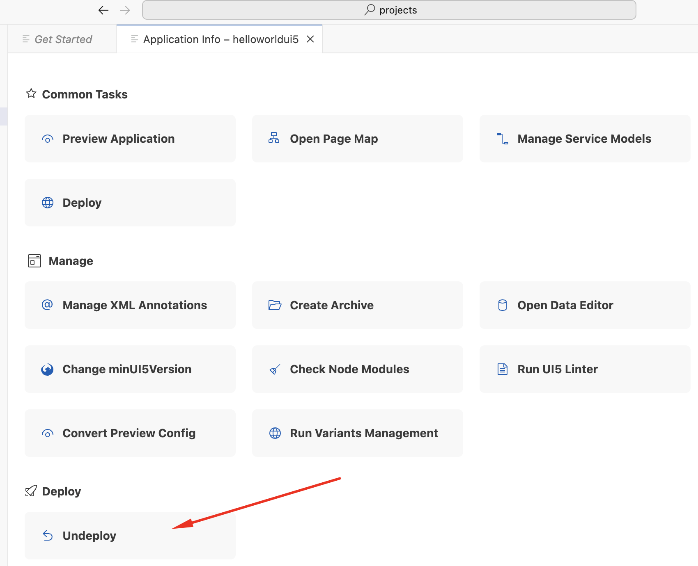
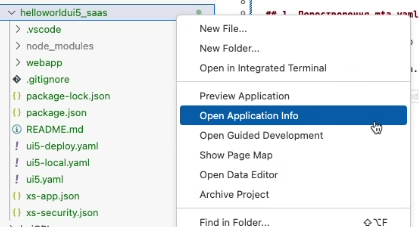
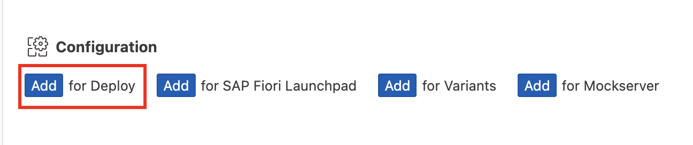
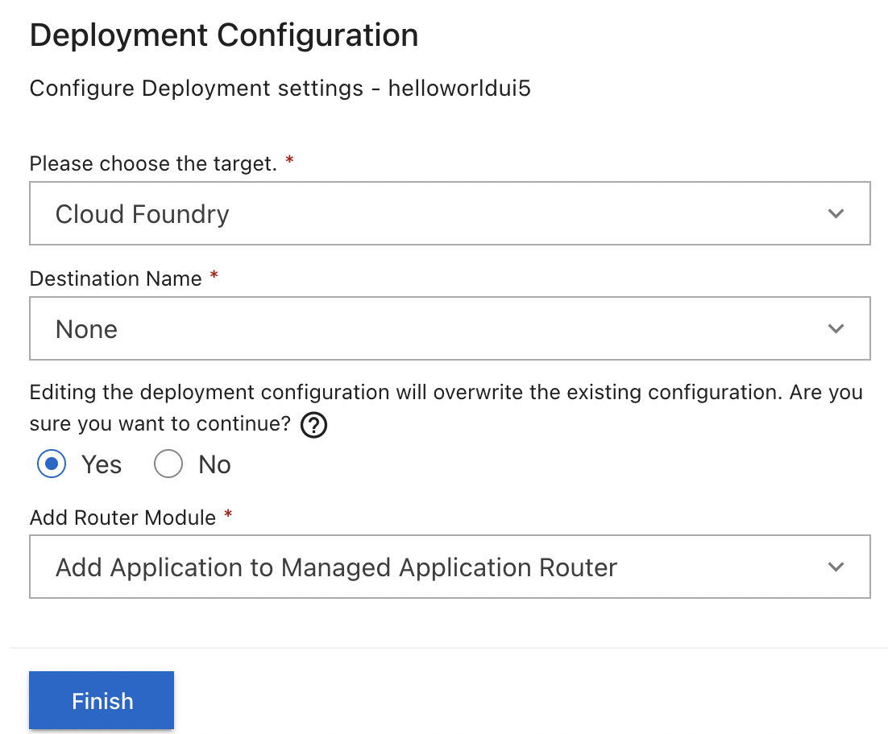
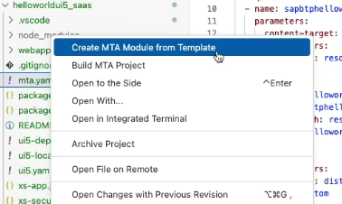
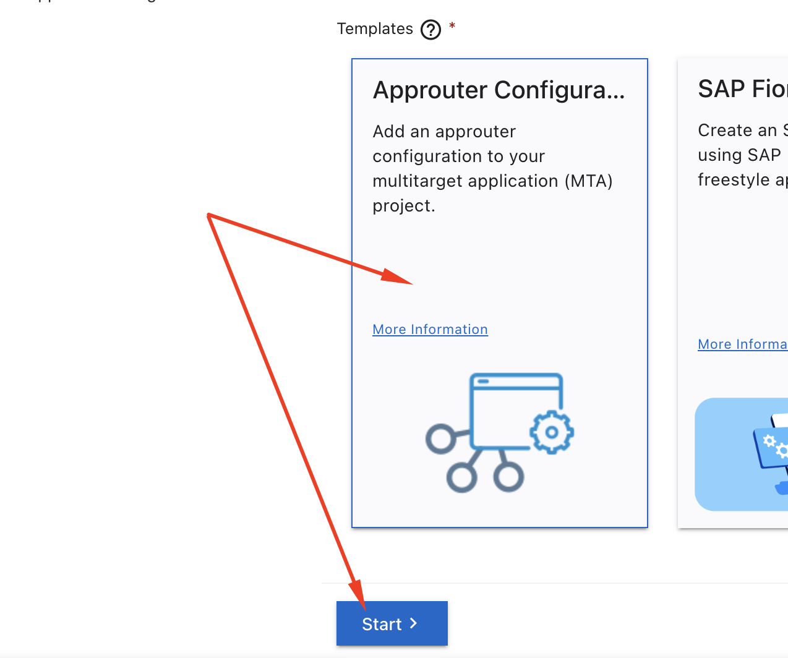
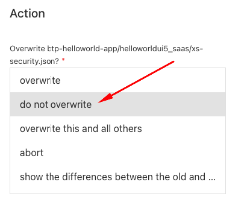
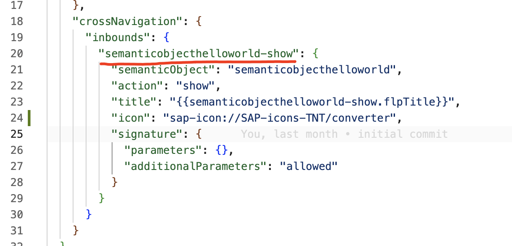
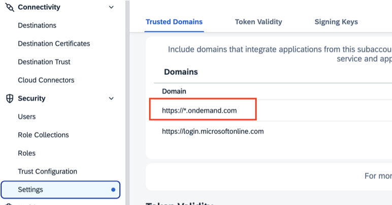

# Приклад перетворення SAPUI5 застосунку з HTML-Rep в SaaS  
Для перетворення звичайного SAPUI5 застосунку в SaaS необхідно виконати наступні кроки:

0. Виконати Undeploy звичайного SAPUI5 застосунку.
1. Перестворити mta.yaml файл.
2. Створити модуль approuter.
3. Змінити xs-app.json файл. 
4. Добавити необхідні сервіси та налаштування в mta.yaml.
5. Виконати налаштування для Work Zone.

## 0. Undeploy звичайного SAPUI5 застосунку
Якщо додаток розгорнутий у субакаунті, то потрібно перейти в Application Info та виконати Undeploy

<p align="center">
    
</p>

## 1. Перестворення mta.yaml

1.1. Робимо копію існуючого проекту (рекомендація).

1.2. Видаляємо існуючий mta.yaml.

1.3. Відкриваємо "Application Info" за допомогою контекстного меню по проекту та запускаємо Add Deploy Config.

<p align="center">
    
</p>

<p align="center">
    
</p>

1.3. Обираємо параметри, як показано на скріні, та тиснемо Finish.

<p align="center">
    
</p>


В результаті виконання попереднього пункту у нас сформувався новий mta.yaml. 

## 2. Створення модуля approuter.

2.1. На файлі mta.yaml відкриваємо контекстне меню та обираємо Create MTA Module from Template  



2.2. Обираємо шаблон Approuter Configuration 

<p align="left">
    
</p>

2.3. На наступному кроці обираємо "do not overwrite" та "Finish"



## 3. Створюємо в корені проєкту каталог sapbtphelloworldui5-approuter та додаємо необхідні файли. 

3.1. Файл xs-app.json

./sapbtphelloworldui5-approuter/xs-app.json
```properties
{
  "authenticationMethod": "route",
  "routes": [
    {
      "source": "^(?:/app|/app/.*)?/resources/(.*)$",
      "target": "/resources/$1",
      "authenticationType": "none",
      "destination": "ui5"
    },
    {
      "source": "^(?:/app|/app/.*)?/test-resources/(.*)$",
      "target": "/test-resources/$1",
      "authenticationType": "none",
      "destination": "ui5"
    }
  ],
  "welcomeFile": "/sapbtphelloworldui5"
}
```
3.2. Файл package.json

./sapbtphelloworldui5-approuter/package.json
```properties
{
	"name": "approuter",
	"description": "Node.js based application router service for html5-apps",
	"engines": {
		"node": ">20"
	},
	"dependencies": {
		"@sap/approuter": "14.4.2"
	},
	"devDependencies": {
		"@sap/html5-repo-mock": "2.1.5"
	},
	"scripts": {
		"start": "node node_modules/@sap/approuter/approuter.js",
		"start-local": "node node_modules/@sap/html5-repo-mock/index.js"
	}
}
```

> **Важливо**: В проекті є два файли `xs-app.json`. Працюємо з тим, який знаходиться в папці роута (в прикладі це sapbtphelloworldui5-approuter)

## 4. Добавляємо необхідні сервіси та налаштування в mta.yaml.

> **Важливо**: В файлі `mta.yaml` використовується назва проєкту в назвах сервісів та модулів. В нашому прикладі - це `sapbtphelloworldui5`. Якщо назва проєкту інша, то потрібно використовувати саме її.

4.1. Налаштовуємо модуль типу `approuter.nodejs`

```properties
# App router ###########################################################
- name: sapbtphelloworldui5-approuter
  type: approuter.nodejs
  path: sapbtphelloworldui5-approuter
  requires:
  - name: sapbtphelloworldui5-html-repo-runtime
  - name: sapbtphelloworldui5-uaa
  - name: sapbtphelloworldui5-destination-service
    group: destinations
    properties:
      forwardAuthToken: true
      name: ui5
      url: https://ui5.sap.com
  - name: saas-registry
  parameters:
    routes:
      - route: https://${subdomain}-${appname}.${default-domain}
      - route: https://${customer_subdomain}-${appname}.${default-domain}
    disk-quota: 256M
    memory: 256M
  properties:    
    TENANT_HOST_PATTERN: "^(.*)-${appname}.${default-domain}"
    CJ_PROTECT_WHITELIST: '[{"protocol": "https","host":"*.ondemand.com"}]' 
    httpHeaders: '[{"Content-Security-Policy":"frame-ancestors https://*.ondemand.com;"},{"X-Frame-Options":"SAMEORIGIN"},{"Cache-control":"no-cache, no-store, must-revalidate"}]'
########################################################################
```
4.2. Модуль типу `com.sap.application.content`
```properties
# Destination deployer module - create CDM DT destination ##########
- name: sapbtphelloworldui5-destination-content
  type: com.sap.application.content
  requires:
  - name: sapbtphelloworldui5-destination-service
    parameters:
      content-target: true
  - name: sapbtphelloworldui5-html5-repo-runtime
    parameters:
      service-key:
        name: sapbtphelloworldui5-app-rt-key
  - name: sapbtphelloworldui5-uaa
    parameters:
      service-key:
        name: sapbtphelloworldui5-uaa-key
  parameters:
    content:
      subaccount:
        destinations:
        - Name: provider_cdm
          ServiceInstanceName: sapbtphelloworldui5-app-rt-service
          ServiceKeyName: sapbtphelloworldui5-app-rt-key
          URL: https://html5-apps-repo-rt.cfapps.eu10.hana.ondemand.com/applications/cdm/kpi_helloworld
        existing_destinations_policy: ignore
  build-parameters:
    no-source: true
#######################################################################  
```
4.3. Модуль типу `html5` залишаємо без змін.
```properties
- name: sapbtphelloworldui5
  type: html5
  path: .
  build-parameters:
    build-result: dist
    builder: custom
    commands:
    - npm install
    - npm run build:cf
    supported-platforms: []
```
4.4. Змінюємо модуль `sapbtphelloworldui5-app-content` типу `com.sap.application.content`
```properties
# HTML5 app deployer module - store xsuaa, backend destinations #######
- name: sapbtphelloworldui5-app-content
  type: com.sap.application.content
  path: .
  requires:
  - name: sapbtphelloworldui5-uaa  
  - name: sapbtphelloworldui5-repo-host
    parameters:
      content-target: true
  build-parameters:
    build-result: resources
    requires:
    - artifacts:
      - sapbtphelloworldui5.zip
      name: sapbtphelloworldui5
      target-path: resources/
  parameters:
    config:
      destinations:
      - name: ui5
        url: https://ui5.sap.com
########################################################################
```

4.5. Переходимо до налаштувань ресурсів. Перший ресурс має назву `sapbtphelloworldui5-auth`. Його варто перейменувати в `sapbtphelloworldui5-uaa` та налаштувати наступним чином.
```properties
- name: sapbtphelloworldui5-uaa
  type: org.cloudfoundry.managed-service
  parameters:
    config:
      tenant-mode: shared
      xsappname: ${appname}
      oauth2-configuration: 
        redirect-uris:
          - https://*.cfapps.eu10-004.hana.ondemand.com/**
      scopes:     
        - name: $XSAPPNAME.Callback
          description: With this scope set, the callbacks for tenant onboarding, offboarding and getDependencies can be called.        
          grant-as-authority-to-apps:
            - $XSAPPNAME(application,sap-provisioning,tenant-onboarding)
      foreign-scope-references:
        - uaa.user
    service: xsuaa
    service-name: sapbtphelloworldui5-xsuaa-service
    service-plan: application
```

> **Важливо**: redirect-uris: [https://*.cfapps.us10-001.hana.ondemand.com/**] використовується лише для US East (VA) - AWS (us10) регіону, в якому в коді є суфікс, наприклад -001. Для Singapore - Azure oauth2-configuration можна видалити, або змінити us10-001 на ap21. 

4.6. Добавляємо ресурс з назвою `sapbtphelloworldui5-html5-repo-runtime`
```properties
# HTML5 app-runtime resource for CDM DT destination ######################
- name: sapbtphelloworldui5-html5-repo-runtime
  type: org.cloudfoundry.managed-service
  parameters:
    service: html5-apps-repo
    service-name: sapbtphelloworldui5-app-rt-service
    service-plan: app-runtime
##########################################################################
```
4.7. Ресурс з назвою `sapbtphelloworldui5-repo-host` лишаємо без змін.

4.8. Добавляємо ресурс з назвою `sapbtphelloworldui5-destination-service`
```properties
- name: sapbtphelloworldui5-destination-service
  type: org.cloudfoundry.managed-service
  parameters:
    config:
      HTML5Runtime_enabled: true
      init_data:
        subaccount:
          destinations:
          - Authentication: NoAuthentication
            Name: provider-rt
            ProxyType: Internet
            Type: HTTP
            CEP.HTML5contentprovider: true
            HTML5.DynamicDestination: true
            HTML5.ForwardAuthToken: true
            URL: https://${subdomain}.launchpad.cfapps.eu10.hana.ondemand.com/
          existing_destinations_policy: ignore
      version: 1.0.0
    service: destination
    service-name: sapbtphelloworldui5-destination-service
    service-plan: lite
```

4.9.  Добавляємо ресурс з назвою `saas-registry`
```properties
- name: saas-registry
  type: org.cloudfoundry.managed-service
  parameters:
    service: saas-registry
    service-plan: application
    service-name: ${appname}-saas-registry
    config:
      xsappname: ${appname}
      appName: ${appname}
      displayName: Hello World
      description: SaaS Hello World
      category: Custom KPI Apps
      appUrls:
        onSubscription: https://${subdomain}-${appname}.${default-domain}/callback/v1.0/tenants/{tenantId}        
        getDependencies: https://${subdomain}-${appname}.${default-domain}/callback/v1.0/dependencies
```
4.10. Добавляємо параметри, які використовуються в налаштуваннях модулів та ресурсів
```properties
  appname: sapbtphelloworldui5  
  subdomain: fcdc23fetrial
  customer_subdomain: customer1-xbdyysmv
```
> **Важливо**: Значення параметрів є індивідуальними для окремих проєктів.

4.11. Добавляємо `build-parameters` в кінець файлу
```properties
build-parameters:
  before-all:
  - builder: custom
    commands:
    - npm install
	- mkdir -p resources 
    - cp workzone/cdm.json resources/cdm.json  
```

Кінцева версія файлу `mta.yaml` повинна виглядати приблизно
[так](helloworldui5_saas/mta.yaml)

## 5. Налаштування для Work Zone

5.1. Вносимо зміни в файл ./webapp/manifest.json. Змінюємо параметр `sap.cloud.service="kpi_helloworld"`
```properties
 "sap.cloud": {
    "public": true,
    "service": "kpi_helloworld"
  }
```

5.2. В корені проєкту створюємо папку `workzone` та розміщуємо там файл `cdm.json` з таким вмістом  
```properties
[
  {
    "_version": "3.0",
    "identification": {
      "id": "wz_helloworld_catalog",
      "title": "Provider: тестові програми",
      "entityType": "catalog"
    },
    "payload": {
      "viz": [
        {
          "appId": "semanticobjecthelloworld",
          "vizId": "semanticobjecthelloworld-show"
        }
      ]
    },
    "texts": [
      {
        "locale": "",
        "textDictionary": {
          "title": "Provider: тестові програми"
        }
      }
    ]
  },
  {
    "_version": "3.0",
    "identification": {
      "id": "wz_helloworld_group",
      "title": "Provider: тестові програми",
      "entityType": "group"
    },
    "payload": {
      "viz": [
        {
          "appId": "semanticobjecthelloworld",
          "vizId": "semanticobjecthelloworld-show"
        }
      ]
    },
    "texts": [
      {
        "locale": "",
        "textDictionary": {
          "title": "Provider: тестові програми"
        }
      }
    ]
  },
  {
    "_version": "3.0",
    "identification": {
      "id": "wz_helloworld_role",
      "title": "Користувач тестових програм",
      "description": "Набір тестових плиток",
      "entityType": "role"
    },
    "payload": {
      "apps": [
        {
          "id": "semanticobjecthelloworld"
        }
      ],
      "catalogs": [
        {
          "id": "wz_helloworld_catalog"
        }
      ],
      "groups": [
        {
          "id": "wz_helloworld_catalog"
        }
      ]
    }
  }
]
```

> **Важливо**: В цьому файлі значення параметрів `"appId"` та `"vizId"` беремо з файлу `manifest.json` з секції `"crossNavigation"`.

<p align="left">
    
</p>


5.3. Змінюємо файл `mta.yaml`. В модулі типу `approuter.nodejs` в розділ `properties` добавляємо до існуючих параметрів наступні
```properties
CJ_PROTECT_WHITELIST: '[{"protocol": "https","host":"*.ondemand.com"}]'
httpHeaders: '[{"Content-Security-Policy":"frame-ancestors https://*.ondemand.com;"},{"X-Frame-Options":"SAMEORIGIN"},{"Cache-control":"no-cache, no-store, must-revalidate"}]'
```

Ці параметри необхідні не тільки для Work Zone, а і для відключення кешування.

5.4. В субакаунті, в якому є підписка на SaaS, в розділі `Security->Settings` добавляємо маску `https://*.ondemand.com` як трастовий домен.



5.5. В Work Zone створюємо аплікацію з зовнішнім посиланням. 

В результаті плитка має відкритися як нативний для Work Zone застосунок (iFrame).
